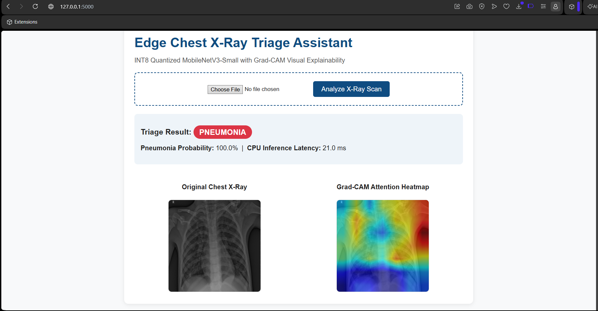
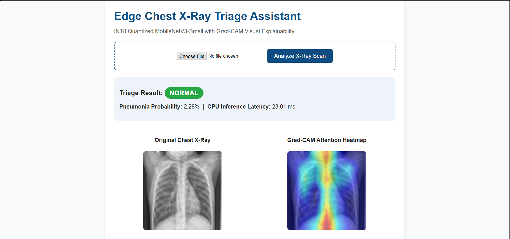

# Edge-Deployed Chest X-Ray Triage with 8-Bit Quantization & Grad-CAM

A lightweight, CPU-ready clinical decision-support prototype designed for low-resource healthcare settings without dedicated GPU servers. This project fine-tunes **MobileNetV3-Small** on clinical chest radiographs to screen for pneumonia, compresses the model via **post-training 8-bit dynamic quantization (`INT8`)**, and provides visual explainability using **Grad-CAM** inside a local Flask web interface.

## Visual Triage & Grad-CAM Explainability

| Positive Case (`PNEUMONIA` — 100.0% Confidence) | Healthy Case (`NORMAL` — 2.28% Pneumonia Prob.) |
| :---: | :---: |
|  |  |
| *Grad-CAM highlights cloudy opacity in the right lung lobe (21.0 ms CPU).* | *Clear lung fields with central anatomical focus (23.01 ms CPU).* |

## Clinical Motivation & Engineering Architecture
In under-resourced clinics where specialist radiologists and hospital GPU servers are scarce, frontline clinicians need fast, interpretable triage tools that run on standard CPU hardware.
- **Backbone Architecture:** `MobileNetV3-Small` pretrained on ImageNet and fine-tuned on the [Chest X-Ray Images (Pneumonia)](https://kaggle.com) dataset (5,863 radiographs).
- **Class Imbalance Handling:** Inverse class-frequency weighting applied to `CrossEntropyLoss` to prioritize **Clinical Sensitivity (Recall)** and minimize false-negative triage errors.
- **Edge Compression (`INT8`):** Applied PyTorch dynamic quantization to linear classifier layers, reducing disk footprint by **28.5%** while preserving diagnostic sensitivity.
- **Visual Explainability:** Integrated **Grad-CAM** on the final convolutional block (`features[-1]`) to highlight pulmonary opacities driving the model's prediction.

## Benchmark Results (CPU Inference)

| Metric | Baseline Model (`FP32`) | Quantized Edge Model (`INT8`) | Impact |
| :--- | :---: | :---: | :---: |
| **Model File Size** | 5.92 MB | **4.23 MB** | **-28.5% smaller** |
| **CPU Inference Latency** | 3.06 ms / scan | **3.08 ms / scan** | Real-time CPU speed |
| **Test Accuracy** | 83.65% | **83.81%** | +0.16% |
| **Clinical Sensitivity (Recall)** | 99.74% | **99.74%** | Zero sensitivity loss |
| **ROC-AUC Score** | 0.9645 | **0.9643** | Virtually identical |

## Quickstart: Run Locally

1. **Clone the repository and install dependencies:**
   ```bash
   git clone https://github.com
   cd edge-chest-xray-triage
   pip install -r requirements.txt
   ```

2. **Launch the Flask triage web application:**
   ```bash
   python app.py
   ```
   Open `http://127.0.0.1:5000` in your browser and upload a chest X-ray image to view the triage probability, CPU latency, and Grad-CAM heatmap.

*(Note: This prototype is developed for research and educational demonstration purposes and is not a certified medical device).*
